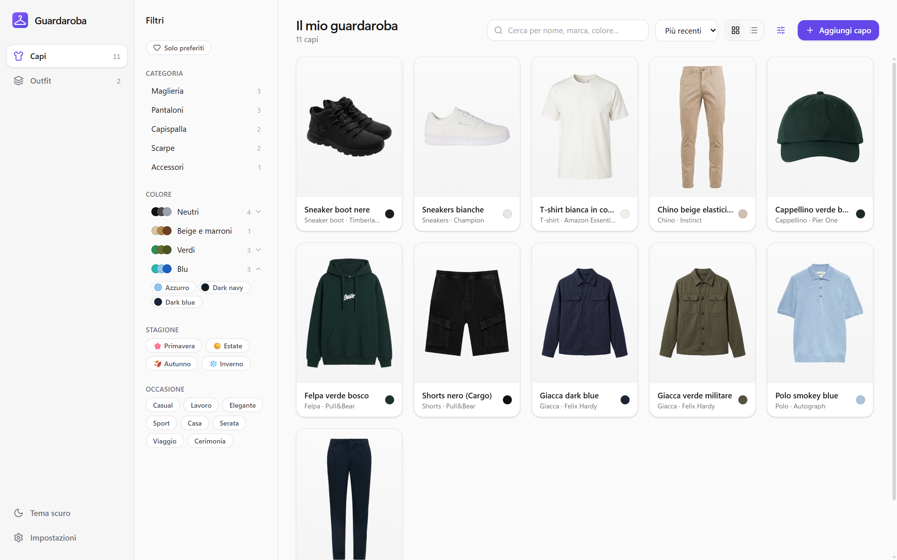
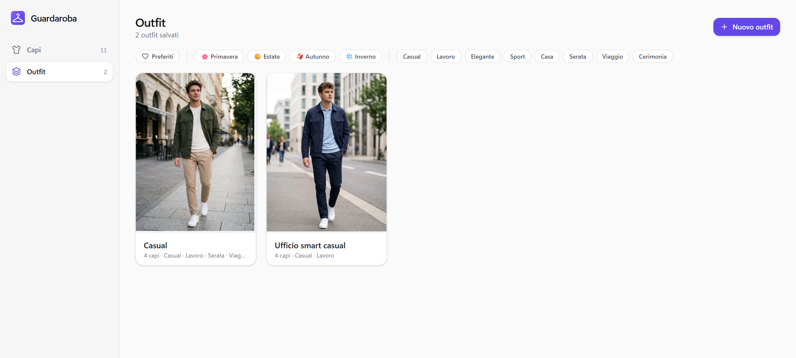

# Guardaroba digitale

App desktop personale (Windows) per catalogare i propri vestiti e comporre outfit.
Funziona completamente in locale: nessun account, nessun server.

> Nuovo PC? Leggi **[SETUP.md](SETUP.md)** per installare i requisiti e spostare i dati.





<sub>Le foto degli outfit negli screenshot sono immagini generate con AI (Google Gemini).</sub>

## Funzionalità

- **Catalogo capi**: foto, categoria e tipo, colori (rilevati in automatico dalla foto), marca, taglia,
  materiale, stagioni, occasioni, prezzo, data di acquisto, tag, note e preferiti.
- **Colori organizzati in famiglie** (neutri, blu, verdi…) con le singole sfumature; il nome di ogni colore
  si può correggere a mano e si possono creare **sfumature personalizzate** (es. "Dark navy"),
  che l'app usa anche per riconoscere in automatico i colori simili.
- **Ricerca e filtri** combinabili, vista a griglia o a lista, ordinamento.
- **Editor foto**: ritaglio, zoom, rotazione e **rimozione dello sfondo con AI locale**
  (RMBG-1.4 su GPU tramite WebGPU, circa 0,2 s a foto; ripiego automatico su CPU).
  Puoi caricare le foto da file, trascinandole o incollandole con Ctrl+V.
- **Creatore di outfit**: tela su cui trascinare, spostare e ridimensionare i capi, con disposizione
  automatica "flat lay", livelli, occasioni e stagioni. A ogni outfit si può aggiungere una **foto facoltativa**
  (es. allo specchio), anche scontornata. Gli outfit si possono duplicare e mettere tra i preferiti.
- **Tema chiaro / scuro / di sistema.**

## Comandi

```powershell
npm install          # dipendenze
npm run app:dev      # avvia l'app in sviluppo
npm run app:build    # crea l'installer (src-tauri/target/release/bundle/nsis/)
```

## Struttura

```
src/                  interfaccia (React + TypeScript + Tailwind)
  pages/              Capi, Outfit (galleria + editor), Impostazioni
  components/         form capo, editor foto, modali, card...
  lib/
    db.ts             accesso al database SQLite
    images.ts         salvataggio e lettura delle foto
    bgRemoval.ts      rimozione sfondo (transformers.js + ONNX Runtime Web)
    colors.ts         estrazione dei colori dominanti e nomi dei colori
    filters.ts        ricerca e filtri
    outfitLayout.ts   disposizione automatica degli outfit
src-tauri/            parte nativa (Rust / Tauri 2)
  src/lib.rs          plugin e migrazioni del database
  tauri.conf.json     configurazione finestra, bundle, sicurezza
```

## Dati

Database e foto: `%APPDATA%\com.giosue.guardaroba` (`guardaroba.db` + `images\`).
Per il backup basta copiare questa cartella ad app chiusa.

In sviluppo (`npm run app:dev`) l'app usa **dati separati** nella stessa cartella
(`guardaroba-dev.db` + `images-dev\`), così le prove non toccano il guardaroba vero.

> ⚠️ Dopo aver aggiunto una migrazione del database (in `src-tauri/src/lib.rs`), rigenera e reinstalla
> l'installer: una versione installata più vecchia si rifiuta di aprire un database già migrato
> ("migration N was previously applied but is missing").

## Modelli AI e licenze

I modelli per la rimozione dello sfondo **non sono inclusi** nel repository: vengono scaricati da Hugging Face
al primo utilizzo e hanno licenze proprie.

| Modello | Licenza |
|---|---|
| [briaai/RMBG-1.4](https://huggingface.co/briaai/RMBG-1.4) (predefinito) | BRIA RMBG 1.4: solo uso **non commerciale** |
| [onnx-community/ISNet-ONNX](https://huggingface.co/onnx-community/ISNet-ONNX) | AGPL-3.0 |
| [Xenova/modnet](https://huggingface.co/Xenova/modnet) | Apache-2.0 |

## Possibili sviluppi

- Suggerimenti di outfit in base al **meteo** (Open-Meteo, gratuito e senza chiave API).
- Generatore di outfit basato su regole: stagione, occasione, abbinamenti di colore, capi poco usati.
- Suggerimenti con un **LLM locale** tramite Ollama, sulla GPU e senza chiavi API.
- Diario "cosa ho indossato" e statistiche (costo per utilizzo, capi dimenticati).
- Export e import del backup direttamente dall'app.
